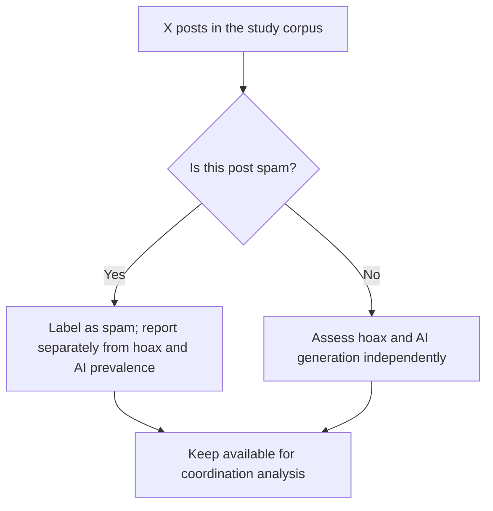

# August 2025 DPR protest analysis

The study covers the August 2025 DPR protest wave on X, not the February–March #IndonesiaGelap wave. The Brandwatch export spans 31 July–31 October 2025; that is the collection window, not a definition of which posts belong to the protest wave. The 2,000-post run tested the pipeline, not the prevalence of hoaxes or AI-generated content. The fact-check queries and study corpus still need to be aligned to the new scope.

## Spam is a separate post label

This diagram describes the agreed design, not the current implementation. A protest hashtag alone is not evidence of spam. One example is unrelated promotion that uses a trending protest hashtag for reach.

## Evidence rules for the next sample run

- **Hoaxes:** Use similarity to retrieve candidates, then verify that the post asserts the same claim that a published fact-check debunks. Do not count related headlines, corrections, or claims with insufficient evidence as hoaxes. See [CheckThat! Task 2](https://ceur-ws.org/Vol-2936/paper-29.pdf) and [Claim Matching Beyond English](https://aclanthology.org/2021.acl-long.347/).
- **AI-generated text:** Benchmark detectors on known-origin Indonesian social posts before using their scores for prevalence. Use matched human and generated examples, and hold out generators and topics to test transfer, following [MultiSocial](https://aclanthology.org/2025.acl-long.36/) and [RAID](https://aclanthology.org/2024.acl-long.674/). Unknown authorship stays unknown.
- **Grok replies:** Classify the interaction using the root post, focal post when available, user prompt, and Grok reply, following [Mei et al.](https://arxiv.org/html/2602.11286v2#S4.SS2). Keep explicit **Truth Arbiter** verdicts about the target claim or media as attributed signals, not independent verification. Informational replies and replies whose target cannot be resolved provide no verdict signal.

## What the matcher can tell us

The matcher finds candidate fact-checks for human review. Its match count is not an estimate of hoax prevalence. A prevalence estimate would require labeling a representative sample that includes posts the matcher did not flag. The [experiment log](hillclimbing.md) records the completed trials and their limitations.
